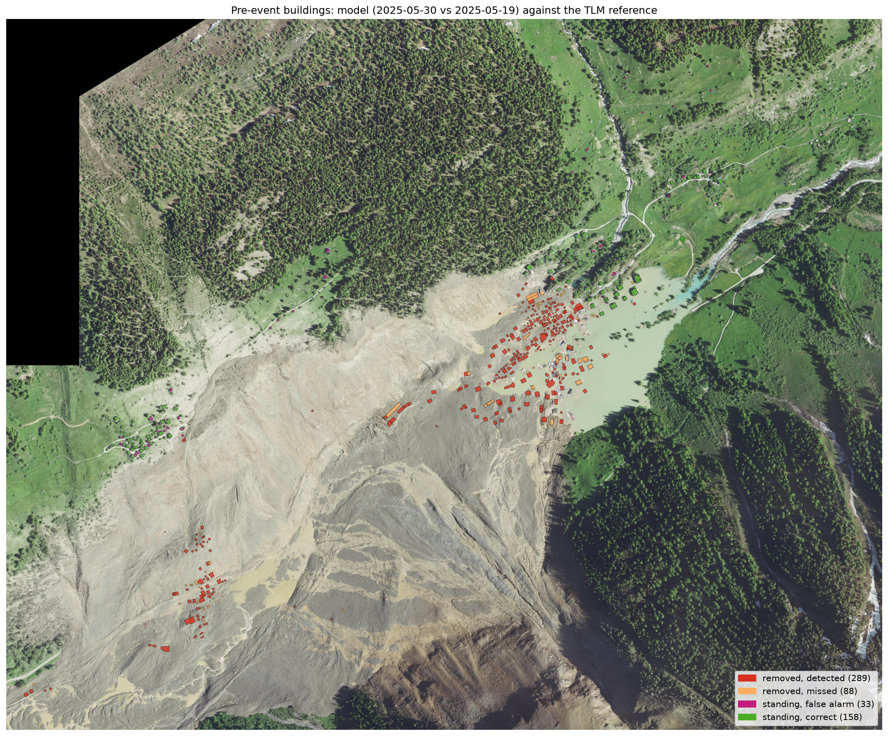

# Building change in Blatten after the ice-rock avalanche of 28 May 2025

GeoAI change detection project for SDS320. A change detector is trained on SWISSIMAGE 2023 with
swissTLM3D building footprints from the Lötschental, then applied to the swisstopo Rapid Mapping
orthophotos of 19 May (pre-event) and 30 May 2025 (post-event) over Blatten.

**Main result:** 289 of the 377 pre-event buildings that swisstopo later removed from swissTLM3D are
detected as changed, and 33 of 191 buildings still standing are wrongly flagged (building-level precision
0.90, recall 0.77, F1 0.83; 0.81 ± 0.02 over three training seeds). The pixel-wise RGB-difference baseline from the course reaches a building F1 of 0.22.



---

## Repository structure

```
blatten-change-detection/
├── README.md
├── environment.yml          conda environment (sds320-env)
├── requirements-lock.txt    full list of package versions the workflow was run with
├── notebooks/
│   ├── 01_data_swissimage_tlm_rapidmapping.ipynb
│   ├── 02_train_change_detector.ipynb
│   ├── 03_blatten_change_map.ipynb
│   ├── 04_interactive_map.ipynb
│   └── train_on_colab.ipynb
├── data/                    not in the repository; re-created by notebook 1
│   ├── raw/                 swissTLM3D building footprints (subset)
│   ├── processed/           imagery subsets and building masks on the 0.5 m grid
│   └── chips/               256 × 256 image/mask chips for training
└── outputs/
    ├── figures/             all figures used in the notebooks
    ├── results/             change rasters, GIS exports, evaluation tables, interactive map
    └── runs/                training logs, results table, selected model
```

## Setup

The environment is defined in `environment.yml`:

```bash
conda env create --file environment.yml
conda activate sds320-env
```

On an Intel Mac, prefix the first command with `SYSTEM_VERSION_COMPAT=0`. Otherwise pip may not find the
binary wheels of `pyproj` and `pyogrio` and tries to build them from source. The pins exist because
torch 2.2.2 is the last release for Intel Macs, and it needs `numpy<2`. On Apple Silicon or Linux with a GPU,
newer versions work and training is much faster. The training notebook picks CUDA, then Apple MPS, then CPU.
`requirements-lock.txt` lists every package version of the environment the notebooks were run with.

In VS Code or Jupyter, select the kernel **Python (sds320-env)**. Internet access is needed for notebook 1
(swisstopo STAC API) and for the basemaps of the interactive map.

## How to run

| Notebook | What it does | Course pages followed | Run time |
|---|---|---|---|
| `01_data_swissimage_tlm_rapidmapping.ipynb` | STAC access to SWISSIMAGE 2023, swissTLM3D and Rapid Mapping, footprint masks, chips, spatial split, comparability checks | L02 data access, L04 masks and chips, L06 quality control and splits, L10 page 2 | ~6 min (CPU) |
| `02_train_change_detector.ipynb` | Trains FC-Siam-diff with TorchGeo `ChangeDetection`, tunes the threshold on validation, tests once | L10 page 8 | ~15 min per seed on a Colab T4; hours on a CPU |
| `train_on_colab.ipynb` | Runs notebooks 1 and 2 on a Colab GPU, once per seed, selects the seed by validation F1, downloads `colab_runs.zip` | L10 page 8, "repeat with a few seeds" | ~50 min for 3 seeds |
| `03_blatten_change_map.ipynb` | Tiled inference on the Rapid Mapping pair, validation against swissTLM3D 2026-02, baseline, GIS export, spot-checks | L10 pages 5, 7 and 9 | ~5 min (CPU) |
| `04_interactive_map.ipynb` | Folium web map: slider between 19 and 30 May, detected change, assessed buildings with tooltips | SDS210 L08 *Going Interactive* + `SideBySideLayers` | ~2 min (CPU) |

Run the notebooks in this order. Each one reads only files written by the previous ones, and its
settings are in one cell at the top.

The `data/` folder is not part of the repository. Run notebook 1 first to download and prepare it. The
selected model checkpoint is included, so notebooks 3 and 4 can be run without retraining once the data
exist.

**Training on Colab.** The model in `outputs/runs/` was trained with `train_on_colab.ipynb`. Upload it at
colab.research.google.com (*File → Upload notebook*), choose *Runtime → Change runtime type → T4 GPU*,
then *Run all*. Notebooks 1 and 2 are stored inside it, so nothing else needs uploading. Unzip the
downloaded `colab_runs.zip` into the project root.

### Outputs

- `outputs/runs/`: training logs, `results.csv` (one row per experiment, with validation and test scores),
  `selected_model.json` (the checkpoint, threshold and normalization that notebook 3 uses), the selected
  checkpoint, and `seed_notebooks/` (the executed training notebook of every run, including the first CPU run).
- `outputs/results/`:
  - `change_map.tif`: binary change raster (EPSG:2056, 0.5 m). The probability raster
    `change_probability.tif` (47 MB) is re-created by notebook 3 and is not in the repository.
  - `change_polygons.gpkg`: change polygons of at least 10 m².
  - `buildings_pre_event_assessed.gpkg`: every pre-event footprint with the share the model flagged and the
    reference label. This is the most useful product for a damage inventory.
  - `evaluation_*.csv`: evaluation tables of the selected model; `seeds/` holds the same tables for every seed.
  - `blatten_interactive_map.html`: the interactive slider map (about 11 MB). The imagery tiles are stored
    inside the file, so it opens offline in any browser; only the swisstopo basemaps need internet.
- `outputs/figures/`: all figures used in the notebooks.

---

## Method

This project follows the TorchGeo `ChangeDetection` task from L10 in the course website, FC-Siam-diff with a pretrained ResNet18, Dice
loss, a Lightning `Trainer` with checkpointing and early stopping on validation F1, threshold tuning on
validation, and a single test.

The main difference is the training data. For the Lötschental there is one date (SWISSIMAGE 2023) with building labels (swissTLM3D). The
pretrained model of pages 5–7 in L10 of the course website, ChangeStar, was built for this situation, and its single-temporal supervision (STAR, Zheng et al. 2021) is the idea used here:

- **STAR pairs:** two different chips are used as "before" and "after", and the change label is
  `mask_i XOR mask_j`.
- **Same-place pairs:** a chip is paired with a radiometrically distorted copy of itself, shifted by up to
  1 m. These pairs contain no change and teach the model to ignore illumination and small misalignment
  (page 2).

The labels are exact by construction, and Blatten is never used for training, model selection or threshold choice.

## Project plan (L10 page 9)

**Change type and output.** The change is buildings destroyed or buried by the ice-rock avalanche and the
lake behind the debris dam. The outputs are a binary change raster, change polygons, and every pre-event
footprint (swissTLM3D 2025-03) with the share of its area the model flags. A building counts as
*changed* if at least 50% of its footprint is flagged.

**Dates and comparability.** Pre: Rapid Mapping quick orthophoto of 19 May 2025. Post: Rapid Mapping
orthophoto of 30 May 2025, two days after the collapse. Both are resampled to 0.5 m in EPSG:2056 with
average resampling.

| Check | Result |
|---|---|
| Co-registration (phase correlation), 19 vs 30 May | 0.10 m |
| Co-registration, SWISSIMAGE 2023 vs 19 May | 0.79 m |
| Co-registration, SWISSIMAGE 2023 vs 30 May | 0.11 m |
| Valid on both dates | 72% of the Blatten area (the 19 May mosaic has gaps) |

The two dates differ in colour and illumination, and the 19 May image still shows snow patches on the
shaded slopes. SWISSIMAGE 2023 is evaluated as an alternative pre-event image.

**Method.** FC-Siam-diff (ResNet18, ImageNet weights, 14.3 M parameters), trained as described above:
up to 80 epochs of 512 random pairs, early stopping after 15 epochs without improvement, three seeds.

| Area | Use | Labels |
|---|---|---|
| Ferden, Kippel, Lauchernalp | training (380 chips) | swissTLM3D 2025-03 |
| Wiler | validation (40 chips) | swissTLM3D 2025-03 |
| Fafleralp | test (56 chips) | swissTLM3D 2025-03 |
| Blatten | event, never used for training or selection | — |

Release 2025-03 is used because all its footprints in the valley carry revision year 2023, the year of the
imagery.

**Threshold strategy.** The seed and the threshold are chosen once, by F1 on the validation pairs (seed 0,
threshold 0.02), and are not changed for Blatten. The validation F1 curve is flat (0.78–0.79 for every
threshold), so the choice matters little. The Otsu-thresholded RGB difference serves as the baseline.

**Validation.**

- **Test area (Fafleralp), synthetic pairs:**

  | Run | Validation F1 | Test F1 | Test IoU |
  |---|---:|---:|---:|
  | First run, laptop CPU (30 epochs × 256 pairs, seed 0) | 0.757 | 0.66 | 0.49 |
  | Colab GPU, seed 0 (selected) | 0.786 | 0.75 | 0.60 |
  | Colab GPU, seeds 0–2 (mean ± std) | 0.781 ± 0.006 | 0.73 ± 0.03 | 0.57 ± 0.04 |
- **Blatten, real event:** the reference comes from swissTLM3D 2026-02, which swisstopo updated after the
  event. A pre-event footprint counts as *removed* if less than 20% of it is still mapped. This gives 377
  removed and 191 standing buildings that are fully covered by both images.
- **Spot-checks:** four zooms (village core, lake, Ried, Weissenried).

---

## Results on Blatten

| T1 (pre-event image) | Pixel F1 | Pixel IoU | Removed buildings detected | Standing buildings flagged | Building precision | Building recall | Building F1 |
|---|---:|---:|---:|---:|---:|---:|---:|
| Rapid Mapping 19 May 2025 (main result) | 0.44 | 0.28 | 289 / 377 | 33 / 191 | 0.90 | 0.77 | **0.83** |
| SWISSIMAGE 2023 | 0.66 | 0.49 | 300 / 377 | 6 / 191 | 0.98 | 0.80 | **0.88** |
| Baseline: RGB difference + Otsu (19 May) | 0.01 | 0.00 | — | — | — | — | 0.22 |

Selected model (seed 0). Over the three seeds, building F1 is 0.81 ± 0.02 with the 19 May image
(0.83 / 0.79 / 0.80) and 0.86 ± 0.02 with SWISSIMAGE 2023; the first CPU run reached 0.82 and 0.87.

- **The building level answers the project question.** Most standing buildings have nothing flagged at all.
- **Longer training helped on the test area, not on Blatten.** Test F1 rose from 0.66 to 0.73 ± 0.03, but
  building F1 on Blatten stayed at about 0.81–0.83. Blatten's errors come from surfaces that the training
  pairs never contain, and more epochs on the same pairs cannot teach those.
- **Pixel precision is low (0.31).** About 80% of the false-alarm area lies away from any building, on
  surfaces the synthetic training pairs never contained:
  - the boulders and lobes of the debris field;
  - objects and turbid patches in the lake;
  - melting snow in the forest on the east slope, about 19,000 m² in the south-east corner alone. The
    GPU-trained model flags more of it than the first CPU run (about 8,000 m²).
- **SWISSIMAGE 2023 as T1 works better.** It lies in the model's training domain and has no snow, and
  building change before the event was rare. The 19 May pair stays the main result because it is the true
  "just before" image.
- **The baseline flags about 40% of the valid area.** It measures "something looks different", not "a
  building changed".

---

## Limitations

- **Synthetic training pairs.** No training pair shows debris, mud, water or snow melt, so these surfaces
  produce false alarms. Flooded houses whose roofs are still visible are often not flagged (correct for the
  image), although swissTLM3D later removed them.
- **The reference is independent but not ground truth.** swissTLM3D 2026-02 reflects mapping until about
  autumn 2025. A house demolished after 30 May counts as "removed", and a damaged house that is still
  mapped counts as "standing".
- **Training length is no longer the limit.** With up to 80 epochs on a GPU, early stopping ended all
  three runs (after 69, 69 and 45 epochs); in the selected run the validation F1 levels off at about 0.78
  from epoch 30 on. Further gains would need better training pairs, for example real no-change pairs
  between SWISSIMAGE 2023 and an earlier SWISSIMAGE flight (swisstopo's web service has an older mosaic
  over Blatten), which would teach the model to ignore genuine differences between flights.
- **Coverage.** The 19 May mosaic covers only 72% of the area. The 17 buildings not fully covered are left
  out of the evaluation.
- **Small test area.** Fafleralp has few buildings (0.7% building pixels), so its test score is noisy.

---

## Data sources

All data are open data from the Federal Office of Topography swisstopo, accessed through the STAC API
(<https://data.geo.admin.ch/api/stac/v1>):

- SWISSIMAGE 10 cm, flight year 2023 (`ch.swisstopo.swissimage-dop10`)
- swissTLM3D, releases 2025-03 and 2026-02, building footprints (`ch.swisstopo.swisstlm3d`)
- Rapid Mapping orthophotos of 19 and 30 May 2025 (`ch.swisstopo.spezialbefliegungen`)
- Basemaps of the interactive map: swisstopo WMTS (national map grey, SWISSIMAGE)

## References

- Daudt, R. C., Le Saux, B., & Boulch, A. (2018). Fully convolutional siamese networks for change
  detection. *IEEE International Conference on Image Processing (ICIP)*, 4063–4067.
- Daudt, R. C., Le Saux, B., Boulch, A., & Gousseau, Y. (2018). Urban change detection for multispectral
  earth observation using convolutional neural networks. *IEEE International Geoscience and Remote
  Sensing Symposium (IGARSS)*, 2115–2118.
- Stewart, A. J., Robinson, C., Corley, I. A., Ortiz, A., Lavista Ferres, J. M., & Banerjee, A. (2022).
  TorchGeo: Deep learning with geospatial data. *Proceedings of the 30th International Conference on
  Advances in Geographic Information Systems (SIGSPATIAL)*.
- Zheng, Z., Ma, A., Zhang, L., & Zhong, Y. (2021). Change is everywhere: Single-temporal supervised
  object change detection in remote sensing imagery. *IEEE/CVF International Conference on Computer
  Vision (ICCV)*, 15193–15202.
- Zheng, Z., Ermon, S., Kim, D., Zhang, L., & Zhong, Y. (2024). Changen2: Multi-temporal remote sensing
  generative change foundation model. *IEEE Transactions on Pattern Analysis and Machine Intelligence*.
- SDS320 lecture material (L02–L10) and the SDS210 course book.

---

## AI statement

Generative AI (Claude, Anthropic) was used as an assistant for the technical implementation of this
project, mainly for:

- **Coding:** help with writing, restructuring and debugging the Python code in the notebooks.
- **Troubleshooting:** help with error messages, package versions and the conda environment.
- **Documentation:** Language editing and structuring of the README.

AI suggestions were reviewed, tested and adapted before they were used. The methodological framework
follows the course material and the literature listed above.

The analysis, interpretation of results, discussion and conclusions primarily (see statement about coding
above) reflect my own understanding. They were developed based on the knowledge acquired during the
lectures (also in other courses) and on independent literature research. All external scientific sources
consulted in preparing this report are acknowledged and listed in the references. I take full
responsibility for the accuracy, integrity and final content of this report.
